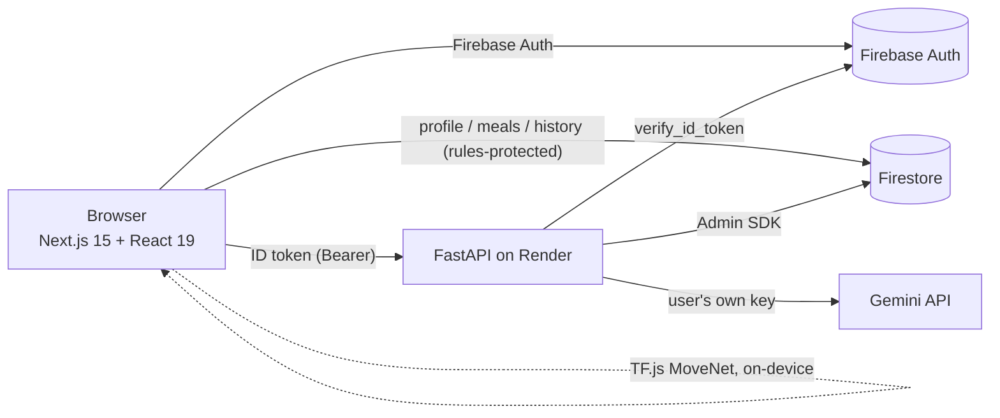

## OURNOLD: The Watcher of your Fitness


**Live:** https://ournold.vercel.app

Ournold is a full-stack, Gen-AI fitness companion. It combines your body data, food log and training history to give
grounded guidance in three areas: **health metrics**, **food / diet** and **workouts**, plus a **streaming AI coach**
that knows your data.

## Features

| Area | What it does |
| --- | --- |
| **Dashboard** | BMI / BMR / calorie target cards with AI notes, weight & BMI history, "today at a glance" (calories, workout, streak) |
| **Food** | Log meals by **photo** (AI macro estimate, editable) or manually (Spoonacular lookup), AI-rated meals, daily AI meal plan within your budget and diet, macro & protein charts |
| **Workout** | AI **weekly plan** (gym / home / bodyweight, swap any exercise), **session logger** (sets, reps, weight, rest timer), progress (streak, weekly volume, personal bests) and a **webcam rep counter** (squat, push-up, curl, press) that runs on-device |
| **Chat** | Token streaming, stop / regenerate / copy, saved conversations with history, suggested prompts, context built from your profile, meals, weight trend and workouts |
| **Accounts** | Email/password auth, password reset, per-user Gemini key stored **encrypted server-side** |

## Architecture



- **Frontend** (`src/`): Next.js App Router, Tailwind 4, Framer Motion, Nivo charts. A shared API client attaches the
  Firebase ID token to every request; pages share one auth guard, nav shell, toast system and error states.
- **Backend** (`backend/app/`): FastAPI. Every route verifies the Firebase ID token and **derives the uid from it**,
  so one user can never read another's data. AI results are cached per user/day in Firestore, with a per-user rate
  limit and bounded Firestore queries.
- **Chat context**: not embedding-based RAG. For each question the server retrieves the user's most relevant
  structured records (profile summary, recent meals, today's macros, weight trend, workout plan and sessions, chosen by
  chat topic) and grounds the model on them. Email, phone and keys are never sent to the model.
- **Data**: Firestore. `users/{uid}` (profile + `currentData`), `history`, `meals` are written by the client under
  security rules. `private/secrets`, `cache`, `chats`, `workouts`, `workoutPlans` are server-only.

## Tech stack

Next.js · React · TypeScript · Tailwind CSS · Framer Motion · Nivo · TensorFlow.js (MoveNet) ·
FastAPI · Pydantic · LangChain (Gemini) · Firebase Auth & Firestore · Docker · GitHub Actions

## Local development

Prerequisites: Node 20+, Python 3.12, a Firebase project (Auth: email/password + Firestore) and a free Gemini key
from <https://aistudio.google.com/apikey>.

```bash
# 1) Frontend
cp .env.example .env.local        # fill in the Firebase web config + NEXT_PUBLIC_BACKEND_URL
npm install
npm run dev                        # http://localhost:3000

# 2) Backend
cd backend
python -m venv .venv && source .venv/bin/activate     # Windows: .venv\Scripts\activate
pip install -r requirements-dev.txt
cp .env.example .env               # fill in FIREBASE_CREDENTIALS and KEY_ENCRYPTION_SECRET
uvicorn app.main:app --reload      # http://127.0.0.1:8000  (docs at /docs)
```

Generate the encryption secret once:

```bash
python -c "from cryptography.fernet import Fernet; print(Fernet.generate_key().decode())"
```

### Environment variables

| Where | Variable | Purpose |
| --- | --- | --- |
| Frontend | `NEXT_PUBLIC_BACKEND_URL` | URL of the FastAPI server |
| Frontend | `NEXT_PUBLIC_FIREBASE_*` | Firebase web app config (see `.env.example`) |
| Backend | `FIREBASE_CREDENTIALS` | Service-account JSON, on one line (or `FIREBASE_CRED_PATH` locally) |
| Backend | `KEY_ENCRYPTION_SECRET` | Fernet key that encrypts users' Gemini keys |
| Backend | `ALLOWED_ORIGINS` | Comma-separated CORS origins |
| Backend | `SPOONACULAR_API_KEY` | Manual food lookup (optional) |
| Backend | `GEMINI_API_KEY` | Optional server key for the public random-fact button |
| Backend | `GEMINI_MODEL` | Defaults to `gemini-2.5-flash` |

### Quality checks

```bash
npm run lint && npm run typecheck && npm test && npm run build     # frontend
cd backend && ruff check . && pytest -q                            # backend
```

CI (`.github/workflows/ci.yml`) runs both on every push and pull request.

## Deployment

1. **Firestore rules**: `npm i -g firebase-tools && firebase login && firebase deploy --only firestore`
   (uses `firestore.rules`).
2. **Backend on Render** (free): New > Blueprint > select this repo (`render.yaml`), then set the secret env vars.
   Free instances sleep when idle: ping `https://<service>.onrender.com/health` every 10 minutes with a free
   uptime monitor to keep it warm.
3. **Frontend on Vercel**: set `NEXT_PUBLIC_BACKEND_URL` to the Render URL plus the `NEXT_PUBLIC_FIREBASE_*` vars.
4. **Existing users' Gemini keys** (from the older version, stored in plain text) are migrated to encrypted storage
   automatically on first use. To migrate everyone at once: `cd backend && python -m scripts.migrate_keys --apply`.

## Screenshots


I hope you like this project of mine! <3
